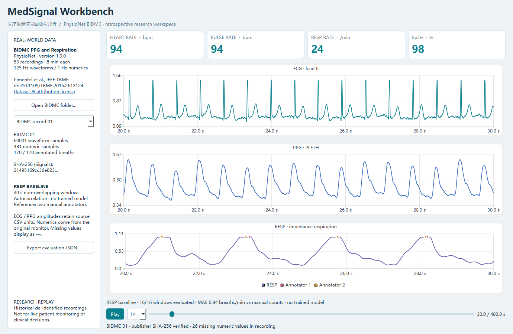
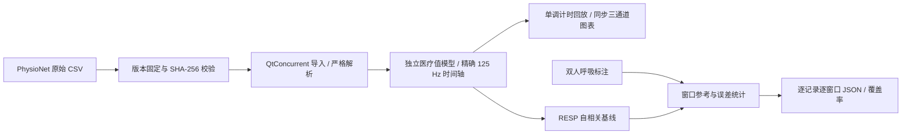

# MedSignal Workbench

[](https://github.com/3086707459-ai/SmartAIIndustrialMonitor/actions/workflows/windows.yml)

**基于 C++17 / Qt 6 的医疗生理信号回放与分析工作台**。使用 PhysioNet BIDMC 真实公开记录，实现 ECG、PPG、呼吸同步回放，监护仪数值展示，双人呼吸标注叠加及可复现的呼吸率基线评测。



主程序为 `MedSignalWorkbench.exe`。仓库 URL 保留原项目名称以保持已有链接与历史记录有效；2026-10-26 起主展示主题切换至医疗生理信号。原 TCP / SQLite 工程链路作为独立工程测试底座保留，历史压力结果不作为医疗算法效果的证据。

## 真实数据与实测结果

使用 [PhysioNet BIDMC 1.0.0](https://physionet.org/content/bidmc/1.0.0/)，由 Pimentel、Johnson、Charlton、Clifton 发布，包含 53 段八分钟记录、125 Hz 波形、1 Hz 数值和两位标注者的呼吸标注。下载器、C++ 导入器和评测工具核对发布方 SHA-256；仓库附带原样第 01 段用于离线演示，完整 153 MB CSV 下载至 Git 忽略目录。许可与引用见 [数据说明](datasets/README.md)。

当前固定参数、自相关 RESP 基线的完整评测：

| 指标 | 2026-10-26 实测 |
| --- | --- |
| 原始文件 | 159 个，发布方哈希匹配 |
| 记录 / 30 秒窗口 | 53 / 848 |
| 可评测窗口 | 728，覆盖率 85.85% |
| Micro MAE / RMSE | 1.23 / 2.56 次/分 |
| Macro MAE | 1.33 次/分 |
| 未计入误差 | 118 个周期性不足窗口；2 个重复人工标注窗口 |

逐记录、逐窗口结果保存在 [评测 JSON](docs/acceptance/bidmc-20261026.json)。这是**直接使用阻抗呼吸波形**估计周期的透明基线，没有训练模型；不是论文中的 PPG 呼吸率估计复现，也不是临床有效性验证。HR、PULSE、RESP、SpO2 卡片来自原监护仪数值，并非本项目重新预测。研究回放不用于实时患者监护或临床决策。

## 构建与运行

Windows 开发依赖：CMake 3.21+、Ninja、C++17，以及匹配编译器的 Qt 6.5+ Core、Gui、Widgets、Network、Sql、Charts、Svg、Concurrent、Test。当前验证环境为 Qt 6.8.3 / MinGW 13.1。

```powershell
git clone https://github.com/3086707459-ai/SmartAIIndustrialMonitor.git
Set-Location SmartAIIndustrialMonitor
./scripts/verify.ps1 -QtRoot E:/qt/6.8.3/mingw_64 -CompilerBin E:/qt/Tools/mingw1310_64/bin

$env:PATH = "E:\qt\6.8.3\mingw_64\bin;E:\qt\Tools\mingw1310_64\bin;" + $env:PATH
./build/demo/bin/MedSignalWorkbench.exe --dataset ./datasets/bidmc-demo
```

`demo` preset 使用 Release、严格编译警告及警告视为错误，关闭可选 ONNX / OpenCV。医疗模块不依赖神经网络权重。UI 支持选择记录、1×/5×/10× 播放、暂停、拖动定位和 JSON 导出；缺失值显示 `—`，不会变成正常值或零。

完整真实数据评测需要 Python 3.9+ 与 curl，不需要第三方 Python 包：

```powershell
python scripts/fetch_bidmc.py --all --mirror
./build/demo/bin/bidmc_benchmark.exe --data ./datasets/bidmc --require-records 53 --output ./build/bidmc-full.json
./build/demo/bin/MedSignalWorkbench.exe --dataset ./datasets/bidmc
```

官方归档镜像和当前版本目录使用同一发布方校验值。评测不足指定记录数、输入哈希不匹配或输出写入失败时返回非零，不能悄悄只测容易的记录。详细数据清洗、窗口口径及局限见 [真实数据验证](docs/medical-validation.md)。

## 工程实现



- 独立 `src/medical` 模型，未将电流、电压等旧工业字段重命名成生命体征。
- 导入工作不捕获 UI 指针；异步完成后一次性替换记录，失败清空当前内容；限制文件和行数，拒绝坏字段、时间错位及篡改数据。
- 保留真实缺失值、原始信号幅度、记录 23 的 -1 秒数值起点；按已知采样率恢复被 CSV 有效位数舍入的波形时间轴。
- 显示两个独立标注流；整理真实乱序标注，重复标注所在窗口不计入误差，处理数量和原因随报告保存。
- 图表与数值按同一时间游标展示；单调时钟决定回放进度，超出新鲜度范围的数值不继续显示。
- Qt Charts 原生波形绘制、SVG 图标、原子文件导出、脱离 SDK PATH 的分发包验收。

## 回归与部署

```powershell
cmake --build --preset demo
ctest --preset demo
./scripts/package.ps1 -QtRoot E:/qt/6.8.3/mingw_64 -CompilerBin E:/qt/Tools/mingw1310_64/bin -OutputDirectory build/packages/medical-demo
./scripts/verify-package.ps1 -PackageDirectory build/packages/medical-demo -EvidenceDirectory build/acceptance/medical-demo
```

当前 **12 个 CTest 目标、95 个行为用例**。其中新增 9 个医疗数据用例和 2 个医疗 UI 用例，使用真实第 01 段验证原始哈希、缺失值、标注时间、无参考泄漏、暂停定位及显示；异常输入用例专门验证损坏文件的拒收行为。原 84 个协议、数据库、线程、背压、状态机与工程 UI 用例继续回归。

[Windows CI](docs/ci.md) 自动严格编译、回归、全 53 段下载与评测、工程链路短压测及医疗版原生 GUI 分发验收。部署包包含第 01 段原始数据、署名许可、评测工具与运行库，验证包内数据哈希、三通道 3,753 个绘制点、缺失 SpO2 和 DLL 来源。进程隔离验收范围与干净虚机的剩余要求见 [部署说明](docs/deployment-acceptance.md)。

## 作品展示

[实习演示与简历建议](docs/internship-guide.md) · [医疗数据验证](docs/medical-validation.md) · [质量记录](docs/quality-review.md)

原工程底座及历史证据：[工程基线](docs/engineering-baseline.md) · [背压契约](docs/backpressure.md) · [历史压力验收](docs/stress-acceptance.md)。这些内容用于解释 C++ / Qt、TCP、SQLite 与多线程基础，不代表已接入真实医疗器械或完成临床验证。
