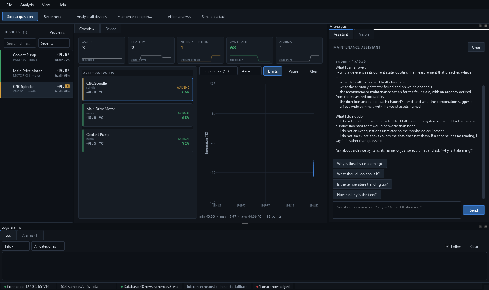
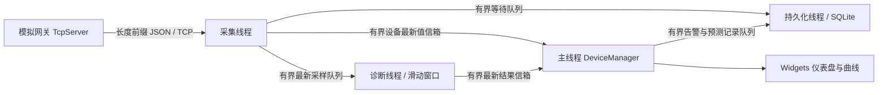

> 历史工程底座文档，最后版本为 2026-10-22。当前医疗主程序与复现步骤以仓库根 README 为准。

# SmartAI Industrial Monitor

[](https://github.com/3086707459-ai/SmartAIIndustrialMonitor/actions/workflows/windows.yml)

面向 C++ / Qt 客户端与工业软件实习的设备监控项目。使用 C++17、Qt 6 Widgets / Charts、TCP 和 SQLite，实现模拟设备采集、实时曲线、设备告警、诊断与维护报告。

项目定位是**可运行、可测试的工业监控原型**。默认数据来自内置模拟网关；诊断使用启发式模型与统计异常检测。仓库未提供已验证的 ONNX 权重、训练数据或准确率报告，不能据此宣称真实工业预测能力。



## 快速运行（Windows / MinGW）

需要 CMake 3.21+、Ninja、匹配 Qt 的 C++17 编译器，以及 Qt 6.5+ 的 Core、Gui、Widgets、Network、Sql、Charts、Svg、Test 模块。当前本地验证环境为 Qt 6.8.3 / MinGW 13.1 / CMake 3.30.5。

先让 `cmake`、`ctest`、`ninja` 可在终端找到，再执行：

```powershell
git clone https://github.com/3086707459-ai/SmartAIIndustrialMonitor.git
Set-Location SmartAIIndustrialMonitor
# 将两个路径替换为本机 Qt 与匹配的 MinGW 安装目录
./scripts/verify.ps1 -QtRoot E:/qt/6.8.3/mingw_64 -CompilerBin E:/qt/Tools/mingw1310_64/bin
```

脚本在 `build/demo` 独立配置、构建与测试，启用 `SAIM_WARNINGS_AS_ERRORS`，关闭可选 ONNX / OpenCV 依赖。任一步失败即停止。

运行程序：

```powershell
$env:PATH = "E:\qt\6.8.3\mingw_64\bin;E:\qt\Tools\mingw1310_64\bin;" + $env:PATH
./build/demo/bin/SmartAIIndustrialMonitor.exe --config ./config --data ./build/demo/runtime
```

默认使用本机端口 9100，监控 3 台配置设备，每 500 ms 采样。无需启动第二个进程。`config/config.json` 关闭随机故障注入，便于重复演示；设备列表继承代码中的默认配置，可通过完整 `devices` 数组替换。

可用 `--no-simulation` 连接独立网关。独立模拟器的参数见：

```powershell
./build/demo/bin/saim_simulator.exe --help
```

如果 9100 已被占用，同时修改配置中的 `network.server.listenPort` 与 `network.client.remotePort`。找不到 DLL 时检查 Qt 与 MinGW 的 `bin` 是否在 PATH 中。分发使用 `scripts/package.ps1`，将运行库、插件、配置、验收工具和哈希清单一起打包，详见 [部署验收](deployment-acceptance.md)。

## 结构与数据流



| 目录 | 职责 |
| --- | --- |
| `src/common` | 值类型、Result、环形缓冲区 |
| `src/core` | 配置、日志 |
| `src/device` | 设备状态、协议、模拟数据 |
| `src/network` | TCP 客户端、网关、重连 |
| `src/database` | SQLite 迁移、事务批写、查询 |
| `src/ai` | 特征提取、统计异常检测、启发式预测、报告 |
| `src/thread` | 采集、诊断、持久化工作线程 |
| `src/ui` | 主窗口、图表、设备详情、告警与辅助分析 |
| `src/app` | 组装对象并连接业务数据流 |

## 可验证的工程点

- 协议处理半包、粘包、异常 JSON、超长声明和帧头重同步；拒绝缺失或非数值遥测字段。
- `QObject::moveToThread` 工作对象模式；定时器跟随所属对象迁移；退出时在所属线程释放资源并等待结束。AI 与持久化线程接收设备配置副本，报告接收主线程生成的值快照。
- SQLite 按事务分批插入，多批中的失败会回滚整个事务；设备表先注册，避免外键失败。每条历史采样保存持久化线程处理时的物理阈值判定，后续阈值变更不重写历史状态。
- 运行中可更新设备列表与阈值，新增设备先注册后落库，删除设备后忽略迟到数据；显式空设备数组清空监控设备。网络监听地址、数据库路径和模型后端变更仍需重启。
- 采样、AI 结果、视觉帧及派生记录经有界信箱传递，不再为每条采样创建 Qt 排队事件。满载时按路径等待／拒收／淘汰，并提供损失、峰值和等待延迟计数；详见 [背压契约](backpressure.md)。
- 无神经网络权重时显式显示启发式后端；样本不足时保留“无诊断”语义。
- 只有遥测能恢复设备在线状态；离线或停用时拒绝诊断更新。同轮预测与异常结果一次性应用，避免中间恢复和重复告警。离线计时与告警抑制使用单调时钟，历史时间戳仍用于展示。

## 测试

```powershell
cmake --build --preset demo
ctest --preset demo
```

运行前同样需要 Qt / MinGW DLL 可被找到。当前套件包含 10 个 CTest 目标、84 个测试用例：

| 目标 | 覆盖 |
| --- | --- |
| `test_common` | 环形缓冲、状态返回值、阈值与诊断状态 |
| `test_device` | 状态迁移、告警升级、离线保护、诊断原子更新、重连诊断清理、历史数据 |
| `test_protocol` | 每个字节位置拆包、超单帧上限的合法粘包、畸形帧恢复 |
| `test_ai` | 特征统计、非等间隔趋势、模型回退、异常基线隔离 |
| `test_database` | 重开迁移、跨批查询、外键失败后的事务回滚 |
| `test_thread` | 定时器线程、重启、对象释放、配置快照、阈值更新落库、报告副本生命周期 |
| `test_backpressure` | 满队列、截止等待、关闭唤醒、计数守恒、并发顺序、重启、锁库退出、输出路径 |
| `test_pipeline` | 实际本机 TCP、工作线程、SQLite、端口复用、运行中设备与阈值更新 |
| `test_ui_smoke` | 离屏窗口渲染、实时遥测、诊断、窗口释放 |
| `test_overload` | 真实 TCP／SQL 锁下的损失核对、主线程阻塞、慢客户端断开后的其他连接 |

测试数量不是覆盖率；尚未运行真实设备或真实 ONNX / OpenCV 后端验收。持续压力测试与独立部署探针不包含在默认 CTest 中，结果范围见下文。

已提供 [Windows CI](ci.md)：提交时自动严格编译、回归测试、60 秒压力测试及部署包隔离验收，失败保留日志；可手动选择 30 分钟压力测试。远程执行结果以 GitHub Actions 对应提交状态为准。

## 持续压力与部署验收

```powershell
# 独立网关线程，16 台设备、每台 50 Hz，持续 30 分钟
./scripts/stress.ps1 -QtRoot E:/qt/6.8.3/mingw_64 -CompilerBin E:/qt/Tools/mingw1310_64/bin -DurationSeconds 1800
# 发布包与脱离 SDK PATH 的原生 GUI 验收
./scripts/package.ps1 -QtRoot E:/qt/6.8.3/mingw_64 -CompilerBin E:/qt/Tools/mingw1310_64/bin -OutputDirectory build/packages/demo
./scripts/verify-package.ps1 -PackageDirectory build/packages/demo -EvidenceDirectory build/acceptance/demo
```

压力工具每 10 秒保存 JSONL 指标，结束后核对实际数据库行数、完整性、队列容量和损失计数。脚本保留被测程序及哈希、配置、硬件信息、峰值内存、关闭耗时，并有测试进程超时看门狗。详细结果见 [压力验收](stress-acceptance.md)。

2026-10-15 版本已完成 **30 分钟、16 台模拟设备、800 条／秒** 验收：发送、接收、提交与数据库实际行数均为 **1,440,000**，存储与 AI 无丢失；峰值工作集 42.21 MiB，存储队列等待延迟 P95 桶上界 10 ms。该延迟不代表端到端落盘延迟，结果不外推后续版本、真实设备或多日运行。2026-10-22 状态机修复后的 [60 秒回归压力报告](acceptance/stress-20261022.json) 核对了 48,000 条采样，存储无丢失。

本机隔离运行包已通过原生窗口、TCP、推理、SQLite、Charts/SVG 与 DLL 来源校验。当前未完成干净虚拟机验收；已提供 `.wsb` 生成器和包内脚本，见 [Windows 部署验收](deployment-acceptance.md)。

维护报告目前明确标注为实时快照：统计来自各设备保留的内存窗口，告警计数为本次启动以来累计值。界面不再提供尚未实现的历史周期选项。

求职演示与简历写法见 [实习作品说明](internship-guide.md)，代码评估及剩余风险见 [质量审查记录](quality-review.md)。
