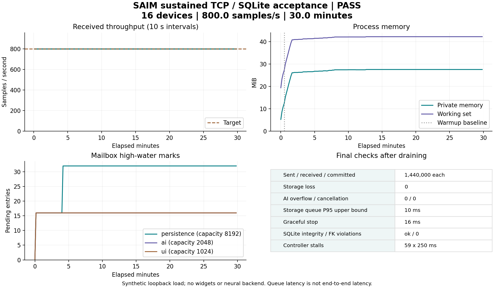

# 持续压力验收（2026-10-15）

## 测试方法

`pipeline_stress` 使用独立 QThread 中创建的 TCP 网关持续发送遥测，经过真实 ProtocolCodec、采集线程、有界信箱、AI 线程和 SQLite 写入。网关不依赖主线程的事件循环；每 30 秒故意阻塞主线程 250 ms，验证后台数据路径不随之停止。

默认负载为 16 台设备 × 50 Hz，目标 800 条／秒，持续 1800 秒。配置、被测程序及 SHA256、源码哈希、CPU／操作系统信息、每 10 秒的 JSONL 指标和最终数据库都保存在单次输出目录。测试不创建 Widgets；原生 GUI 另由部署探针验证。

```powershell
./scripts/stress.ps1 -QtRoot E:/qt/6.8.3/mingw_64 -CompilerBin E:/qt/Tools/mingw1310_64/bin -DurationSeconds 1800 -OutputDirectory build/acceptance/my-30min
```

可将时长设为 `7200` 做 2 小时耐久运行，或调整 `-DeviceCount`、`-IntervalMs`；这些参数对应新的实验，不能直接套用既有结果。输出目录必须是新目录，避免历史行数污染核对。

## 自动通过条件

- 达到完整指定时长，实际发送速率不低于目标的 80%。
- 发送、接收、已提交和实际 SensorData 行数相等，普通负载下存储与 AI 无拒收／淘汰／取消。
- 显示信箱无容量淘汰；同设备覆盖计入 `coalesced`，不要求逐条显示。
- 派生记录无拒收或写入失败，分析结果无设备容量淘汰。
- 所有信箱峰值不超过容量，停止上游后 15 秒内排空，正常关闭不超过 5 秒。
- SQLite `integrity_check=ok`，`foreign_key_check` 无违规。
- 存储信箱等待延迟 P95 桶上界不超过 1 秒；进程峰值工作集不超过 512 MiB；预热 30 秒后的私有内存净增长不超过 64 MiB。
- 独立进程看门狗以“测试时长 + 120 秒”为默认总截止，超时写失败证据并终止测试进程，绝不记为通过。

P95 指入队后等待到出队的延迟桶上界，不是网络到磁盘端到端时延。内存门槛只用于当前规模回归，不构成泄漏检测器；应结合 `timeline.jsonl` 看平台是否稳定，不能把启动期窗口填充当作泄漏。

## 本轮证据

正式 30 分钟运行已通过，`passed=true`、`failures=[]`。运行目录为 `build/acceptance/stress-final-30min`；源码随附 [最终 JSON](acceptance/stress-20261015.json)、[10 秒采样时间线](acceptance/stress-20261015-timeline.jsonl) 和 [运行环境与源码哈希](acceptance/stress-20261015-run-info.json)。原始 SQLite 数据库和被测二进制保留在本地运行目录，不提交到源码仓库。

| 指标 | 实测结果 |
| --- | --- |
| 负载与持续时间 | 16 台模拟设备 × 50 Hz，1800 秒 |
| 发送／接收／提交／实际数据库行数 | 均为 1,440,000，实际 800 条／秒 |
| 存储丢失、AI 淘汰／取消 | 均为 0 |
| 持久化队列峰值／容量 | 32 / 8192 条 |
| AI、GUI 队列峰值／容量 | 16 / 2048、16 / 1024 条 |
| 存储队列等待延迟 P95 桶上界 | 10 ms（不是端到端时延） |
| 峰值工作集／私有内存 | 42.21 / 27.54 MiB |
| 主线程故意阻塞 | 59 次，每次 250 ms |
| 排空后正常关闭 | 16 ms |
| SQLite 完整性／外键违规 | ok / 0 |

GUI 按设备合并 1,177,888 条中间值，这是显示路径的既定策略，不计作存储丢失。测试未创建 Widgets，GUI 原生渲染由独立部署验收覆盖。

发布前已逐项核对源码与长测保存的 SHA256 一致。运行信息还包含 `publishedSourceBlobs`，用于按 Git 规范化后的文件内容核对；例如 `git rev-parse HEAD:src/thread/SampleInbox.h` 应与该条目的 `gitBlobSha1` 一致，避免 Windows CRLF 与仓库 LF 换行差异造成误报。



生成图表：`python scripts/plot-stress.py build/acceptance/stress-final-30min docs/acceptance/stress-20261015.png`（需 matplotlib，仅用于报告）。

短时预检：15 秒、12,000 条采样，发送／接收／入库一致，存储与 AI 无丢失。先前在部署路径修复前启动的一次长测已主动中断，记录于 `build/acceptance/stress-30min/interrupted.json`，不计入通过结果。

故障注入证据来自默认测试套件：

- `test_backpressure`：满队列截止等待、消费者／关闭唤醒、队列计数守恒、并发 FIFO、重启；1024 条锁库待处理样本的失败计数及停止上限。
- `test_overload`：32 条持久化信箱在真实 SQL 锁下超时拒收，核对“接收 = 入库 + 拒收 + 存储丢失”；主线程阻塞 1 秒而独立网关和落库继续；512 台模拟设备发送时断开不读数据的慢客户端，健康客户端继续接收。

这不是故障条件下的零丢失证明，也不覆盖多日运行、真实工业设备、网络跨机延迟、磁盘掉电恢复或真实神经网络后端。
